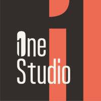

<p align="center"><picture><source media="(prefers-color-scheme: dark)" srcset=".github/assets/togo-mark-dark.svg" /></picture></p>

<h1 align="center">togo</h1>
<p align="center"><em>Go, the artisan way.</em></p>
<p align="center">
  <a href="https://github.com/togo-framework/togo/actions/workflows/ci.yml"></a>
  <a href="https://codecov.io/gh/togo-framework/togo"></a>
  <a href="https://goreportcard.com/report/github.com/togo-framework/togo"></a>
  <a href="https://pkg.go.dev/github.com/togo-framework/togo"></a>
  <a href="LICENSE"></a>
</p>

**togo** is an open-source, API-first application framework for the **Go + sqlc +
Atlas + GraphQL/OpenAPI + React** stack (TanStack by default, Next.js optional). It brings a Laravel-artisan-like
developer experience to Go: a powerful CLI, code generators, a unified
[marketplace](https://to-go.dev/marketplace) of plugins, AI agents, skills, MCP
tools and UI components, Supabase auth/dashboard by default, a fast `togo deploy`,
and first-class Claude Code / MCP integration.


⭐ **If togo saves you time, star the repo** so more Go developers find it. Docs: [to-go.dev/en/docs](https://to-go.dev/en/docs) · Plugins: [to-go.dev/marketplace](https://to-go.dev/marketplace)

This repository is the **microkernel** — the thin core every togo app builds on.
The kernel provides configuration, a priority-ordered hook/event bus, a plugin
loader + registry, a database driver registry, and server bootstrap. Everything
else (REST, GraphQL, auth, dashboard, resources) is a **plugin** installed by the
CLI.

## The togo organization

| Repo | Role |
|---|---|
| [`togo`](https://github.com/togo-framework/togo) | Microkernel (this repo) |
| [`cli`](https://github.com/togo-framework/cli) | The `togo` binary — generators, db, install, mcp, deploy |
| [`create-togo-app`](https://github.com/togo-framework/create-togo-app) | Project template rendered by `togo new` |
| [`plugin-template`](https://github.com/togo-framework/plugin-template) | Starter for togo plugins |
| [`mcp`](https://github.com/togo-framework/mcp) | MCP server exposing generators to AI agents |
| [`claude-togo`](https://github.com/togo-framework/claude-togo) | The togo Claude Code plugin — agents, skills, rules, hooks + auto-wired MCP |

## Quickstart

```bash
go install github.com/togo-framework/cli@latest   # installs the `togo` binary
togo new myapp && cd myapp
togo make:resource Post title:string body:text:nullable
togo generate          # sqlc + gqlgen + Atlas migrate + OpenAPI
togo serve
togo install claude    # optional: add the togo AI agent team to Claude Code
```

## Principles

- **API-first** — every resource is exposed over GraphQL *and* REST/OpenAPI 3.1.
- **Everything is a plugin** — the core is a microkernel; capabilities are installed.
- **Generator-first** — `togo make:resource` scaffolds across six targets from one manifest.
- **Dynamic by default** — connections, URLs, endpoints come from `togo.yaml` + `.env` + hooks.
- **AI-native** — projects ship `.claude/` skills/agents + a `.mcp.json` wired to both the local *and* the web MCP; `togo install claude` adds the 15-agent togo team to Claude Code.

## Sponsor

ToGO is free and open source, built and maintained by [Fady Mondy](https://github.com/fadymondy).
It is the framework behind a whole family of open-source production apps ([Zekra](https://github.com/fadymondy/zekra),
[Mahaam](https://github.com/fadymondy/mahaam), [Moharrik](https://github.com/fadymondy/moharrik),
[Hosbah](https://github.com/fadymondy/hosbah)) and 200+ plugins. Sponsoring ToGO keeps all of them moving.

**[Sponsor ToGO →](https://to-go.dev/sponsor)**

<p>
  <a href="https://to-go.dev/sponsor"></a>
  <a href="https://github.com/sponsors/fadymondy"></a>
  <a href="https://buymeacoffee.com/fadymondy"></a>
</p>

## Built with ToGO (showcase)

Open-source products running in production on togo; read their code to see a full-size togo app:

- [**Mahaam**](https://github.com/fadymondy/mahaam): project management for agencies (projects, issues, time, invoices, client portal, AI agents over MCP)
- [**Hosbah**](https://github.com/fadymondy/hosbah): server management and app hosting (zero-downtime deploys, databases, backups, tunnels)
- [**Moharrik**](https://github.com/fadymondy/moharrik): the AI engine for a business (inbox, CRM, leads, email marketing, automation)
- [**Zekra**](https://github.com/fadymondy/zekra): shared long-term memory for AI agents over MCP, with its engine shipped as togo plugins

More, and how to add yours: **[SHOWCASE.md](SHOWCASE.md)**.

## License

MIT

## More open source from the same author

- [TomatoPHP](https://tomatophp.com): 60+ open-source FilamentPHP plugins for Laravel
- [Laravilt](https://laravilt.com): Laravel admin panels rendered with Inertia on Vue 3 or React 19
- [Zekra](https://zekra.dev): long-term memory for AI agents over MCP

Built by [Fady Mondy](https://fadymondy.com).

---

## 💎 Premium sponsors

togo is proudly sponsored by **ID8 Media** and **One Studio**.

<p align="center">
  <a href="https://id8media.com"></a>
  &nbsp;&nbsp;&nbsp;&nbsp;&nbsp;&nbsp;
  <a href="https://one-studio.co"></a>
</p>
